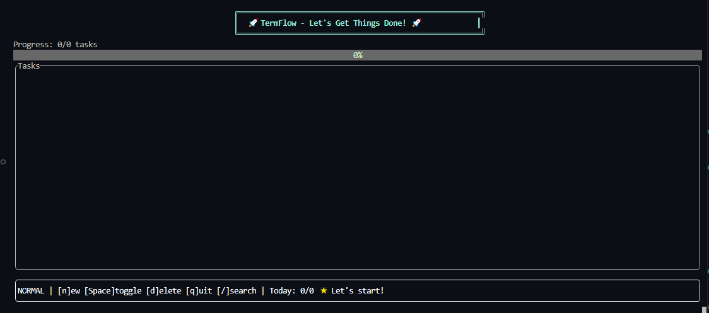

# TermFlow

A keyboard-driven task manager for the terminal, written in Rust with [ratatui](https://github.com/ratatui-org/ratatui) and [crossterm](https://github.com/crossterm-rs/crossterm). It keeps a task list with categories and priorities, runs a Pomodoro timer against a selected task, and shows simple completion statistics.



## What it does

- Tasks move through Todo, In Progress and Done. New tasks default to Medium priority, and the list is sorted High, Medium, Low, then by creation time.
- Five built-in categories (Personal, Work, Learning, Health, Finance) plus custom categories with a chosen emoji and one of seven colors.
- Live search over task titles and descriptions.
- A Pomodoro timer (25 minute work sessions, 5 or 15 minute breaks) that records completed sessions on the task they were started for.
- Time blocks of 25, 45, 60 or 90 minutes, scheduled to start five minutes from now, with the next five shown in the time-blocking view.
- A statistics view with completion counts, a per-category breakdown, an activity heatmap and a daily streak counter.
- An insights view with a productivity score, a seven-day completion chart, the hours you most often finish tasks, and suggestions picked by fixed rules (completion rate, Pomodoro time, category spread, time of day).
- Five color themes: Cyberpunk, Forest, Ocean, Sunset, Midnight.

## Build and run

TermFlow uses the Rust 2024 edition, so it needs Rust 1.85 or newer.

On Linux, the `rodio` and `notify-rust` dependencies need the ALSA and D-Bus headers to compile:

```bash
sudo apt install pkg-config libasound2-dev libdbus-1-dev
```

Then:

```bash
git clone https://github.com/Abdalla-Eldoumani/termflow.git
cd termflow
cargo run --release
```

The binary ends up at `target/release/termflow`. It opens full screen in the terminal's alternate screen; press `q` to quit. A welcome screen appears on first launch (any key dismisses it).

## Keys

Main list:

| Key | Action |
|-----|--------|
| `j` / `k` or arrow keys | Move selection |
| `n` | New task (`Tab` picks a category, `Enter` saves) |
| `Space` | Cycle the selected task's status |
| `d` | Delete the selected task |
| `/` | Search (`Enter` keeps the filter, `Esc` clears it) |
| `p` | Start a Pomodoro for the selected task |
| `b` | Start a break (the long one after every fourth work session in a run) |
| `T` | Time blocking, then `1` to `4` for 25, 45, 60 or 90 minutes |
| `s` | Statistics |
| `i` | Insights |
| `f` | Focus mode (the selected task on its own) |
| `D` | Dependencies view |
| `t` | Next theme |
| `e` | Export to `termflow_export.json` in the current directory |
| `w` | Show the welcome screen |
| `q` | Quit |

In the timer, `Space` pauses or resumes and `s` or `Esc` stops it. In the category picker, choosing the last entry starts a custom category: type the name and press `Enter`, use `Tab` to cycle the emoji and `Enter`, then `Tab` or `1` to `7` for the color and `Enter`. `Esc` backs out of every view.

## Data

Tasks, categories, stats and the chosen theme are stored as JSON in `termflow_data.json` under the platform data directory from the `directories` crate (on Linux, `~/.local/share/termflow/`). Each save first copies the previous file to `termflow_data.bak`.

## Limitations

- The file is written when you add a task (at most once every five seconds), when you change theme, and when you quit with `q`. Closing the terminal or a crash loses any changes since the last save.
- Dependencies are a placeholder: the view lists other tasks, but adding or removing a dependency only shows a message.
- Focus mode only displays the selected task. The `P` shown in its footer is not wired up.
- There is no way to set a task's priority, description or due date from the interface; every task is Medium.
- `rodio` and `notify-rust` are declared but not used, so there are no sound or desktop notifications.
- There are no tests.

## Project layout

```
src/
  main.rs        terminal setup, event loop, key handling per mode
  app.rs         application state, task operations, timer and stats logic
  timer.rs       Pomodoro session state and countdown
  models/        Task, Category, Priority, Pomodoro and time-block types
  storage/       JSON load, save, backup and export
  ui/            all rendering
  theme.rs       theme colors
```

## License

MIT. See [LICENSE](LICENSE).
